<a href="https://bhargav.adepu.co.in">
  <picture>
    <source media="(prefers-color-scheme: dark)" srcset="./assets/hero-dark.svg">
    
  </picture>
</a>

  <a href="https://bhargav.adepu.co.in"><b>Portfolio</b></a> &nbsp;·&nbsp;
  <a href="https://linkedin.com/in/bhargavvz"><b>LinkedIn</b></a> &nbsp;·&nbsp;
  <a href="https://huggingface.co/bhargavvz"><b>Hugging Face</b></a> &nbsp;·&nbsp;
  <a href="https://bhargav.adepu.co.in/writing/"><b>Writing</b></a> &nbsp;·&nbsp;
  <a href="https://bhargav.adepu.co.in/Bhargav_Resume.pdf"><b>Résumé</b></a> &nbsp;·&nbsp;
  <a href="mailto:bhargavadepu@outlook.com"><b>Email</b></a>

 

Most of my work sits at one junction: **a model that has to survive contact with a real deployment** behind an API, inside an app somebody actually opens, on a machine that costs money to keep running.

Every number below is the number the repository reports, including the ones that aren't flattering.

 

### Selected work

<a href="https://github.com/bhargavvz/GSoc-VLC"><picture><source media="(prefers-color-scheme: dark)" srcset="./assets/card-vlc-dark.svg"></picture></a><a href="https://github.com/bhargavvz/aquasafe"><picture><source media="(prefers-color-scheme: dark)" srcset="./assets/card-aquasafe-dark.svg"></picture></a>

<a href="https://huggingface.co/bhargavvz/MedGPT"><picture><source media="(prefers-color-scheme: dark)" srcset="./assets/card-medgpt-dark.svg"></picture></a><a href="https://github.com/bhargavvz/PhotonQR"><picture><source media="(prefers-color-scheme: dark)" srcset="./assets/card-photonqr-dark.svg"></picture></a>

<a href="https://huggingface.co/bhargavvz/SkinGuard-AI"><picture><source media="(prefers-color-scheme: dark)" srcset="./assets/card-skinguard-dark.svg"></picture></a><a href="https://github.com/bhargavvz/SCAM"><picture><source media="(prefers-color-scheme: dark)" srcset="./assets/card-meridian-dark.svg"></picture></a>

Also: <a href="https://bhargav.adepu.co.in/work/vaultlock/">VaultLock</a> · <a href="https://github.com/bhargavvz/Communitifx_v2">Communitfx</a> · <a href="https://bhargav.adepu.co.in/#work"><b>all twenty-one, with case studies →</b></a>

 

### The path so far

<picture>
  <source media="(prefers-color-scheme: dark)" srcset="./assets/timeline-dark.svg">
  
</picture>

 

### What I reach for

<picture>
  <source media="(prefers-color-scheme: dark)" srcset="./assets/stack-dark.svg">
  
</picture>

 

<table>
<tr>
<td valign="top" width="50%">
<b>Writing</b>  
<a href="https://bhargav.adepu.co.in/writing/why-42-percent/">Why 42% is the honest number</a> 
AquaSafe's first model taught me more than its successor.  
<a href="https://bhargav.adepu.co.in/writing/seven-hours/">Fitting 589M parameters into seven hours</a> 
One H100, a hard stop, and the config it forced.  
<a href="https://bhargav.adepu.co.in/writing/photon-from-a-browser/">Speaking Photon from a browser</a> 
A web page as a PhotonQR sender, judged by the app's own code.
</td>
<td valign="top" width="50%">
<b>Don't take my word for it</b>  
<a href="https://bhargav.adepu.co.in/">Draw a digit</a> 
A 40 KB CNN in ~170 lines of TypeScript, running in your browser.  
<a href="https://bhargav.adepu.co.in/">Send me a message across an air gap</a> 
The site is a PhotonQR sender. Point the app at your screen.  
<a href="https://doi.org/10.1109/IC-SIT69723.2026.11735771">Read the IEEE paper</a> 
IC-SIT 2026 · water-pollution disease-burden forecasting.
</td>
</tr>
</table>

 

<a href="mailto:bhargavadepu@outlook.com">
  <picture>
    <source media="(prefers-color-scheme: dark)" srcset="./assets/footer-dark.svg">
    
  </picture>
</a>
